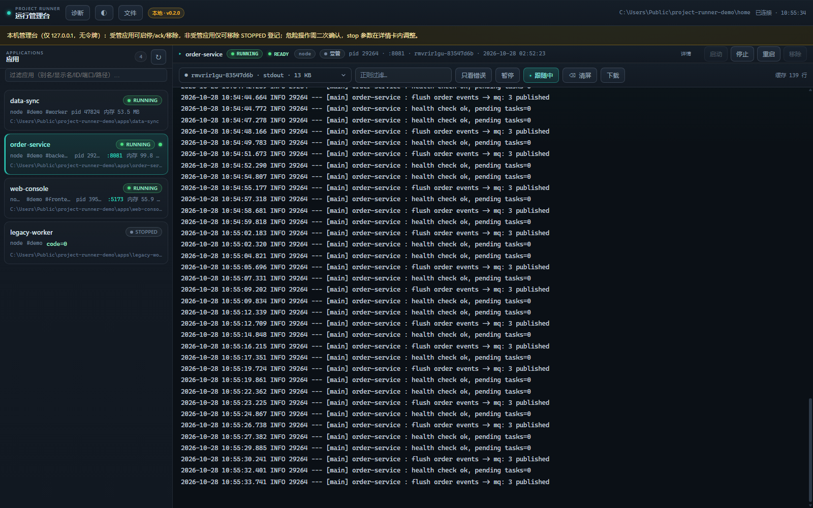
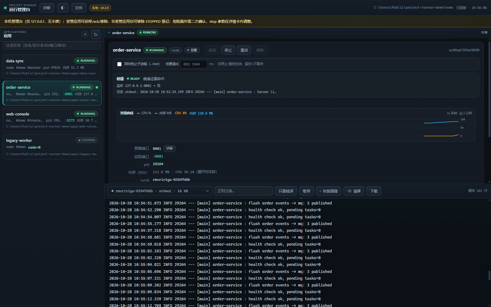
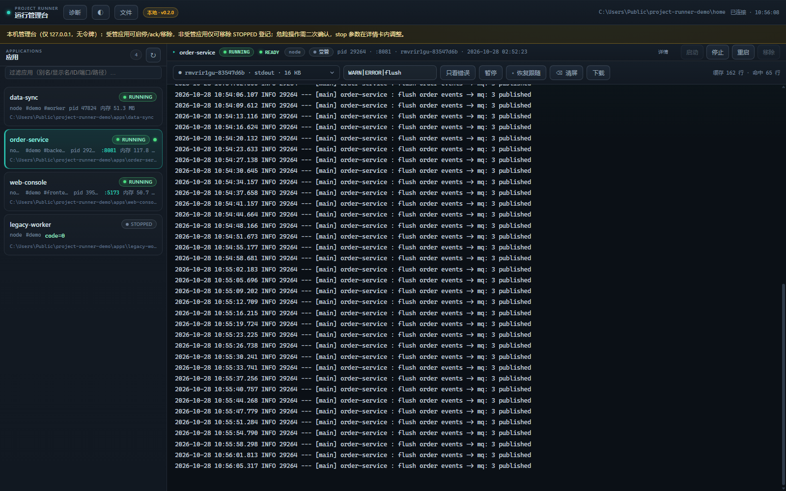
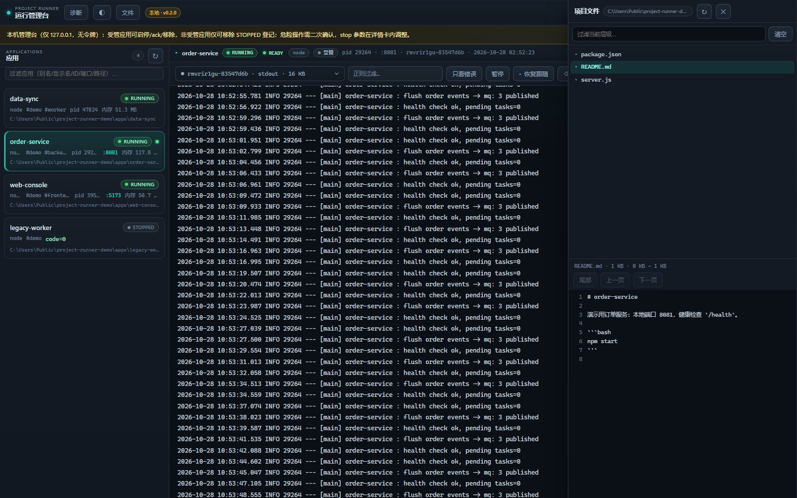

# Agent App Manager

[](https://github.com/duyiliu/agent-app-manager/actions/workflows/ci.yml)

**Agent App Manager：统一管理由 AI Coding Agent 启动并登记的本地应用，提供跨 Agent、跨会话的生命周期管理、状态监控、日志和 Web 控制台。**

在业务仓库中让 Agent 识别并启动项目、查看日志和验证热加载。受管应用会统一登记，之后可在其他目录或 Agent 会话中查看状态、启停和查日志；无法安全托管的启动会标记为非受管。附带本机 Web 管理台。

支持 Java / Spring Boot（含 standalone JRebel）、Python、Node / Vue / React / Vite，以及任意可核验身份的真实可执行进程。

## 快速开始

### 1. 安装

**官方安装（固定版本 `v0.10.0`）：**

```bash
npx skills add duyiliu/agent-app-manager#v0.10.0 --skill agent-app-manager -g
```

**国内网络加速安装（第三方 `skills-cn`）：**

```bash
npx skills-cn@latest add duyiliu/agent-app-manager#v0.10.0 --skill agent-app-manager -g -y
```

两种方式均从本仓库安装相同的 `agent-app-manager` Skill；`skills-cn` 为第三方 CLI，加速下载不代表其 CLI 版本与官方完全同步。`-g` 表示全局安装，`-y` 表示跳过交互确认。安装命令按 Tag 固定版本，可在 `/releases` 查看最新版本后再替换 `#vX.Y.Z`。

安装后以 Agent 实际加载的 Skill 目录为准解析脚本，不同运行器的目录可能不同。已安装版本可通过 `manager.mjs version` 或管理台顶栏徽标核对；升级后重跑安装命令即可。

原 `project-runner` Skill 已更名为 `agent-app-manager`。安装不会自动清理旧副本；新版 `migrate`、`doctor` 和首次升级提示会列出仍存在的旧 Skill 路径，但不会自动删除。确认新 Skill 可用后再自行卸载旧版本，避免触发冲突。

### 从旧版本升级

`v0.5.0` 是旧版本，仍使用 `~/.project-runner/`，不包含下述自动复制功能。安装支持数据复制的新版本后，按以下顺序升级：

1. 停止旧版管理台及其受管应用，确保旧日志进程退出。
2. 使用 `npx skills add` 安装支持迁移的新版本。安装本身不会迁移数据；首次运行新版普通管理命令（例如 `list`）时自动检查并尝试复制。
3. 仅存在旧数据目录时，新版会复制数据到 `~/.agent-app-manager/`；新旧目录都存在时不会自动复制或合并。检查应用登记、配置和历史日志是否正常。
4. **卸载旧 Skill**：新版 `migrate`、`doctor` 和首次升级提示会列出 `~/.agents/skills`、`~/.codex/skills`、`~/.claude/skills` 下仍存在的 `project-runner`，并给出可直接执行的删除命令；manager 不自动删除。确认新版可用后自行执行，避免同时加载。旧数据目录可暂留作备份。

复制后的两个数据目录相互独立，后续更改不会同步；不要同时使用新旧版本管理应用。退出通知脚本使用的 `PROJECT_RUNNER_*` 环境变量继续兼容。旧版仍可继续使用旧目录，但不会自动升级到新版本。

支持复制的新版本也可手动检查和重试（将 `<skill-dir>` 替换为新版 Skill 实际安装目录）：

```bash
node "<skill-dir>/scripts/manager.mjs" migrate --dry-run
node "<skill-dir>/scripts/manager.mjs" migrate
```

预览列出旧目录、新目录和发现的活动进程或锁，不写入；正式命令有阻塞时返回错误，处理后可重试。新目录已存在时不会覆盖或合并；该命令只处理默认目录，不接受 `--home`。复制完成后旧目录保留。输出中的 `legacySkills` 为探测到的旧 Skill 安装位置，仅报告，不卸载。

### 2. 让 Agent 启动项目

在目标仓库中直接说：

> 启动这个项目

Agent 会读取项目说明、已有启动脚本和构建配置，识别启动方式。目标明确且可安全托管时，启动并自动登记；存在多个候选或无法托管时，会先说明情况。运行数据保存在 `~/.agent-app-manager/`。

默认数据目录为 `~/.agent-app-manager/`。仅存在旧 `~/.project-runner/` 时，首次普通命令会复制到新目录，完整保留旧目录；新旧目录同时存在时，升级逻辑不做任何操作，正常使用新目录。复制期间仅调整副本中运行记录的数据目录路径，不改旧记录。检测到旧应用、日志进程或锁仍活跃时，暂缓复制并提示，本次继续使用旧目录，停止后下次命令重试。显式 `--home` 和 `start/restart --dry-run` 不触发复制。Skill 名称为 `agent-app-manager`。

Java 项目默认 `mode: java`；只有项目已有 JRebel 配置（启动脚本引用 agent、仓库有 `rebel.xml`、构建文件含插件）或你明确要求时，才走 `mode: jrebel` 并检查 standalone JRebel 环境。

### 3. 查看与管理

将下面的路径和 `my-app` 替换为实际 Skill 安装目录和应用别名：

```bash
node "<skill-dir>/scripts/manager.mjs" list
node "<skill-dir>/scripts/manager.mjs" status my-app --ready
node "<skill-dir>/scripts/manager.mjs" logs my-app --lines 100
node "<skill-dir>/scripts/manager.mjs" ui
```

`ui` 默认监听 `http://127.0.0.1:8199`，浏览器打开即可查看全局应用、日志和项目文件。命令在任何目录都能用，不需要 `cd` 到业务仓库。

在应用详情中，若项目包含 scenario-test 接入目录（默认 `scenario-test`，缺失时自动发现项目内自定义目录）且包含配置、`index.html` 和项目内 CLI，可点击「打开场景测试」启动并打开独立工作台；再次点击会复用，停止工作台不影响业务应用。工作台使用独立的本地端口，新标签被拦截时可点击显示的地址。打开工作台不会自动执行场景。

完整的默认目录优先；默认目录缺失或不完整时查找项目内自定义目录。发现多个完整候选时报告目录歧义，不自动选择。

完整参数见 [manager 参考](skills/agent-app-manager/references/manager.md)，Agent 侧规程见 [SKILL.md](skills/agent-app-manager/SKILL.md) 第 8 节。

## 能力

| 能力 | 说明 |
| --- | --- |
| 项目识别 | 从仓库证据确定运行时、模块、入口、profile、端口和启动参数，不凭记忆补全 |
| 受管启动 | 直连真实可执行进程，或用命令模式托管 `npm run dev`、`mvn spring-boot:run` 等脚本 |
| 跨项目 / 跨会话 | 受管启动自动登记；已登记应用可在任意目录启动，其他 Agent 会话也能核验和操作 |
| 生命周期 | `start` / `stop` / `restart` / `remove`，支持 `--dry-run`、`--wait-ready`、`--tree`、`--grace` |
| 分组批量 | desc `tags` + `--tag`，逐条执行、失败继续、不回滚 |
| 状态与健康 | 进程状态、端口探测、业务就绪证据、资源快照、`health` 总览、`doctor` 自检 |
| 日志 | 按批次查看 stdout / stderr，支持合并、跟随、正则过滤、上下文与时间过滤；统一日志源覆盖非受管线索与项目 `.tmp` |
| 自动重启 | 可选 `restartPolicy=on-failure`，按 `maxRestarts` / `backoffMs` 有界重启，`BACKOFF` / `DEAD` 可见 |
| 退出钩子 | 可选 `onExit`；非监督应用在查询时发现退出后执行，监督应用在结束监督时执行，人工停止不触发 |
| JRebel | 初始化 / 检查 standalone JRebel、许可与 `rebel.xml`，验证加载与热更新证据（仅 Java） |
| 管理台 | 本机 Web 界面，默认只读；启停 / 移除须页面二次确认 |

## 受管范围与状态

只管理**由本 Skill 启动并登记**的进程。IDEA / 手工命令行 / Docker 启动的外部进程不接管、不停止；仅在端口冲突诊断时查看占用信息。默认不修改项目配置、`rebel.xml`、启动脚本或数据库，需要改动时先取得授权。

受管形态二选一：

- **直连**：`exe` + `args`，目标必须是可核验身份的真实可执行文件（Windows `.exe` / `.com`，Linux ELF）。`.cmd` / `.bat` / `.ps1` 包装、WindowsApps 执行别名、`#!` 脚本不能作为 `exe`；这类脚本请用命令模式，或解析到真实解释器。
- **命令模式**：`command` + `expectedImage`。manager 拉起脚本或复合命令后，在后代进程中按映像名发现唯一真实目标并托管。多个候选会拒绝（`DISCOVERY_AMBIGUOUS`），不会任选一个。

两者都无法定位唯一目标时，仍可按原授权执行，但只登记为非受管，不承诺跨会话启停。

| 状态 | 含义 |
| --- | --- |
| `RUNNING` | 进程存活（不等于业务就绪） |
| `STOPPED` | 有退出证据 |
| `STARTING` | 启动进行中 |
| `BACKOFF` | 异常退出后等待自动重启 |
| `DEAD` | 自动重启次数耗尽 |
| `UNKNOWN` | 中断 / 身份不可核验 / 非受管记录 |

`STARTING` / `UNKNOWN` 属于未结记录：默认拒绝 `start` / `remove`。人工核验旧进程已退出后，用 `--ack-unresolved <runId>` 显式放弃旧账，证据保留在 `prevRuns`。不要删除 runtime 记录或日志来绕过。

`stop` 默认是**有界强制终止**，不承诺优雅关机；`--grace <ms>` 先发优雅信号，超时后再强制终止。跨 Agent 会话的存活与验收结论以 [design.md](docs/design.md) 的状态为准。

## 命令速查

`<ref>` 为别名或 `appId`。

| 命令 | 用途 |
| --- | --- |
| `detect --root <dir>` | 只读识别项目并输出启动候选，不登记或启动 |
| `list [--watch [--interval <ms>]]` | 全局应用列表与实时状态；`--watch` 周期输出，JSON 模式为 NDJSON |
| `status <ref> [--probe] [--ready] [--resources] [--watch]` | 单应用详情；`--probe` 实际监听端口，`--ready` 业务就绪，`--resources` 单次 RSS / CPU |
| `status --tag <t>` | 按标签批量查询 |
| `start <ref> [--force] [--dry-run] [--wait-ready [--ready-timeout <ms>]]` | 用已保存配置启动；`--wait-ready` 就绪才返回 0，超时为退出码 6 且进程保持 RUNNING |
| `stop <ref> [--tree] [--grace <ms>]` | 停止受管实例 |
| `restart <ref> [--force] [--tree] [--grace <ms>] [--dry-run]` | 确认退出后重启 |
| `start --tag <t>` / `stop --tag <t>` / `restart --tag <t>` | 按标签批量操作；须检查 `results[].ok`，命令退出码不代表每条都成功 |
| `logs <ref> [--lines N] [--stream ...] [--run <runId>] [--follow] [--src ...] [--grep <regex>] [--since ...]` | 统一日志源查看与过滤 |
| `health` | 全部应用的状态 / 端口 / 就绪总览（只读） |
| `port <N>` | 端口占用诊断（只读，不停止外部进程） |
| `doctor` | 环境与数据自检（只读，不修复） |
| `remove <ref>` | 移除登记；须无存活受管实例，运行证据保留 |
| `prune [--dry-run] [--apply]` | 回收超期日志、死锁残留、孤儿临时文件；默认 dry-run |
| `ui [--port N] [--open]` | 本机 Web 管理台，默认 `127.0.0.1:8199` |

通用参数：`--home <绝对路径>` 使用隔离数据目录，`--json` 输出稳定 JSON。

退出码：`0` 成功、`1` 用法、`2` 未找到、`3` 状态冲突、`4` 环境依赖、`5` 数据损坏或内部错误、`6` 就绪超时。使用 `--wait-ready` 前须配置 `readyLogPattern` 或 `readyUrl`。

## 平台与依赖

| 平台 | 支持情况 |
| --- | --- |
| Windows 11 + PowerShell 7 | 支持；身份核验 / 终止 / 端口诊断走 `ps/proc.ps1` |
| Linux | 支持；走 `/proc`，不依赖 pwsh |
| macOS | 不支持（无 `/proc`），命令以 `PLATFORM_UNSUPPORTED` 拒绝 |

- Node.js 20+（CI 使用 22）。
- Linux 安全停止需要 Python 3.9+ 与内核 pidfd 支持；缺少时明确拒绝终止，不回退到有 PID 复用竞态的 `kill(pid)`。
- 不新增 npm 依赖、Daemon、数据库或 MCP，仅使用 Node 内置模块。

## 本地 Web 管理台

`manager ui` 按需启动，前台常驻，Ctrl+C 即退出；不注册开机自启、不拉起守护进程。默认固定 `127.0.0.1:8199`（`--port 0` 为随机端口），仅本机可访问、无令牌。界面只展示已登记应用（含非受管记录）；IDEA / 手工启动且未登记的进程不会出现。



*总览：左侧为已登记应用，右侧为选中应用的详情与按批次日志。*

### 使用细节

1. **连接与刷新**：打开地址后，顶栏显示数据目录与最近连接时间；列表 / 状态约 4 秒、日志尾部约 1 秒自动刷新，页面隐藏时统一降频至 30 秒，也可点列表右上角手动刷新。Ctrl+C 退出 `ui` 后地址即不可用，仅关闭浏览器页面不会停止该进程。
2. **选择与筛选应用**：点击卡片切换应用。卡片展示进程状态、受管 / 非受管、就绪状态、模式、标签、pid、端口和内存快照；搜索框支持别名、显示名、ID、模式、端口、路径与标签。`STARTING` / `UNKNOWN` 等未结记录会在卡片和详情中标出，不能直接重复启动。
3. **详情与资源曲线**：点右上角「详情」展开。健康区给出端口监听、业务就绪证据（`readyLogPattern` / `readyUrl`）与诊断信息；`prevRuns` 与未结记录证据也在这里核对。详情展开后每 5 秒采样一次 CPU / RSS，绘制最近 5 分钟的曲线，收起详情即停止采样。

   

4. **查看日志**：日志源下拉可选当前 / 历史受管批次、非受管线索和项目 `.tmp` 兼容日志。工具栏支持合并 stdout / stderr、正则过滤、只看错误、暂停 / 恢复跟随、清屏和下载；过滤激活时只下载命中行。首次加载时顶部可能出现「从文件起始读取」提示，跟随滚动后移出视口。

   

5. **只读文件浏览**：点顶部「文件」打开当前应用根目录，可逐层展开、过滤和分页预览文本文件。`.git`、`node_modules`、`.env*`、常见私钥与许可文件不会显示，路径穿越与符号链接会被拒绝。

   

6. **启动 / 停止 / 重启 / 移除**：详情卡按钮与 CLI 同一实现和安全边界，所有生命周期操作都要在 10 秒内再次点击「确认…」才执行；`--tree` 与优雅退出毫秒数在详情卡内设置，只作用于 stop / restart。非受管应用仅允许移除 STOPPED 登记；`STARTING` / `UNKNOWN` 未结记录需人工核验进程已退出后，点「ack 并启动」并再次确认。
7. **端口诊断与自检**：预期端口旁的「诊断」只读查询占用信息（同 `manager port`），不接管外部进程；顶部「诊断」执行 `manager doctor` 并原样展示结果，不自动修复。

原单项目 Viewer 已移除，能力并入本台。管理台地址仅本机可达，**不要转发**；日志与文件预览可能含敏感信息，外发前先检查。

## 数据目录

```text
~/.agent-app-manager/                 # Windows: %USERPROFILE%\.agent-app-manager\
├── registry.json                  # 已登记应用与可复用启动描述
├── runtime/<appId>.json           # 当前 / 最近运行实例与证据
├── logs/<appId>/<runId>.*.log     # 受管批次日志
└── locks/                         # 应用锁
```

升级不清理数据目录。`env` 中的字面值会明文保存到注册表，不能用于机密；机密请通过系统环境变量 + `envRefs`，或 `envFile` 传入（后者仅在启动时读取，值不写入 registry / runtime / status / UI）。

## 仓库结构

```text
README.md
docs/
├── design.md                      # 跨项目管理设计与验收基线
├── images/                        # README 管理台截图
├── ops/                           # 运维记录
└── verification/                  # 验收证据
skills/agent-app-manager/
├── SKILL.md                       # Agent 路由与通用边界
├── references/                    # 按需加载：java / python / node / other-stacks / manager / jrebel-setup
└── scripts/
    ├── manager.mjs                # CLI 入口
    ├── log-writer.mjs             # detached 日志转发 / 轮转 / 重启监督
    ├── exit-watcher.mjs           # 命令模式目标的真实退出状态记录
    ├── lib/                       # 领域模块（detect / launch / lifecycle / logs / resources / ...）
    ├── manager-ui/                # 管理台页面、前端脚本与本地服务
    ├── ps/proc.ps1                # Windows 进程适配
    ├── linux/                     # Linux pidfd 终止与退出等待 helper
    └── test/                      # 跨平台冒烟测试
examples/spring-boot-demo/         # 本地测试项目
```

## 本地测试项目

仓库内置三个本地示例，分别用于验证项目识别、受管启动、管理台日志和健康检查：

- [Spring Boot](examples/spring-boot-demo/README.md)：Java 17，端口 `18273`，还可验证 JRebel 热加载。
- [Python / Flask](examples/python-demo/README.md)：端口 `18274`，需安装 Flask。
- [Node.js](examples/node-demo/README.md)：端口 `18275`，只使用 Node.js 内置模块。

三个示例仅监听本机，不依赖数据库；启动和接口检查步骤见各自的 README。

## 开发与测试

改动 `manager.mjs` / `manager-ui` / `lib` 后运行：

```bash
npm test          # 完整冒烟
npm run check     # 全部 .mjs 语法检查 + 脱敏 / 健康 / 环境 / 运行时冒烟
```

`npm test` 依次覆盖：日志轮转、管理台、健康总览、生命周期与未结记录、env / envFile、`--wait-ready`、remove / prune / 统一日志源、日志过滤、管理台日志源跟随、真实进程生命周期。CI 在 `windows-latest` 与 `ubuntu-latest` 上运行语法检查与核心冒烟；macOS 未纳入支持范围。

## 开发边界

Skill 负责理解目标项目；确定性脚本只负责需要可靠重复执行的操作。不要为了支持更多语言预先引入通用适配框架、Daemon、数据库或 MCP。跨项目能力的验收要求见 [design.md](docs/design.md)。
